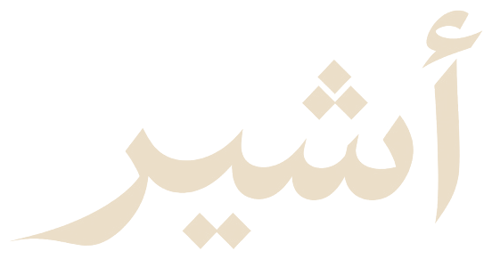

<div align="center">
  
  <h1>استوديو أَشِير للمقولات | ASHEER Studio</h1>
  <p><strong>صانع المقولات التحريرية والبطاقات الأدبية الفاخرة — بديل Illustrator المتخصص في التايبوغرافي العربي</strong></p>
</div>

---

## نبذة عن الخدمة

**استوديو أَشِير (ASHEER Studio)** هو تطبيق ويب متكامل لتصميم بطاقات الاقتباسات، الأبيات الشعرية، والمقالات التحريرية القصيرة بهوية بصرية فاخرة مستوحاة من أرقى دور النشر والمجلات الثقافية العربية. يعمل الاستوديو مباشرة في المتصفح (على الكمبيوتر والجوال) دون الحاجة لأي برامج تصميم معقدة، مع تصدير فوري فائق الدقة يصل إلى **Ultra 4K**.

---

## ✨ أبرز المميزات

### ١. محرك خط ثمانية الذكي للكشيدة والأحرف المرسلة (OpenType Engine)
- **موازنة الأسطر التلقائية بالكشيدة المائلة:** يحلل المحرك كل سطر في الفقرة ويمد الحرف قبل الأخير في الكلمات العربية المتصلة تلقائياً ليتساوى طول الأسطر بدقة البكسل (Justified Arabic Typography).
- **مشكّل كلمات العنوان التفاعلي (Word Shaper):** إمكانية الضغط على أي كلمة في العنوان أو بيت الشعر لتفعيل **الحرف المرسل / الكاف المبسوطة (`ss01`)** أو زيادة/إنقاص **الكشيدة المائلة (`ـ`)** لكل كلمة على حدة.
- **الفتحة الممتدة الذكية (`ss03`–`ss07`):** تمديد حركة الفتحة تلقائياً عندما توضع فوق حرف ممدود بالكشيدة.
- **تنبيهات جمالية ذكية:** يراقب المحرك قواعد التوازن البصري وينبه المستخدم عند تفعيل الحرف المرسل في كلمتين متجاورتين في السطر نفسه.

### ٢. القوالب التحريرية الأربعة
يعرض المعرض الرئيسي (`index.html`) 4 قوالب تحريرية مصممة بعناية:
1. **القالب الأول — الكرت الكحلي المصمت («ليس لشيء»):**
   - مقاس `1080×1350` (4:5) أو `2160×2700` (4K).
   - عنوان مركزي ضخم مع ياء مرسلة، سطر عربي فرعي موزون، ثلاث معينات هندسية (`◆ ◆ ◆`)، فقرة إنجليزية موازية (`LTR`)، وشريط فوتر خماسي يضم الحساب، الكلمات الدلالية، مخطوطة «محبة»، وختم الباركود الدائري (`QR Seal`).
2. **القالب الثاني — بطاقة الأبيات الشعرية والتصوير («من نعيم الدنيا»):**
   - دمج الصور الفوتوغرافية العلوية مع بطاقة النص السفلية للأبيات والمقولات القصيرة.
3. **القالب الثالث — قالب الافتتاحية والمقالات («ما وراء الخَلق»):**
   - مخصص للنصوص التأملية والمقالات الأدبية ذات الأعمدة المضبوطة بالكشيدة.
4. **القالب الرابع — البطاقتين المتداخلتين («وكيف أغفى»):**
   - مقاس `1080×1920` (9:16) أو `2160×3840` (4K).
   - بطاقة علوية داكنة (تقبل لوناً مصمتاً أو صورة خلفية كاملة مع تحكم بالسطوع، التباين، التشبع، الدفء، والتمويه + السحب المباشر بالماوس/اللمس) متداخلة مع بطاقة سفلية للشرح وتوقيع الكاتب.

### ٣. مكتبة خطوط عربية منتقاة + رفع خطوطك الخاصة
- **عائلة خط ثمانية الرسمية كاملة (15 وزناً):**
  - `Thmanyah Serif Display` (للعناوين والشعر)
  - `Thmanyah Serif Text` (للنصوص القرائية)
  - `Thmanyah Sans` (للنصوص الرقمية والحديثة)
- **خطوط ثقافية وتراثية مدمجة:** `Lyon Arabic Display`، `Somar Sans`، `اليمامة (Alyamama)`، `زين (Zain)`، `المشرف ثلث ونسخ`، `بسملة`، `المصمك`، `ثروت عمارة رقعة`، `رقعة لوب`، `خط الثلث الكلاسيكي`، `عام الإبل`، `عام الحرف اليدوية`، `29LT Zarid Display`، `سمرقند`، `أميري`، `عارف رقعة`، `شهرزاد`، و`كلزار`.
- **رفع خط خارجي فوري:** إمكانية رفع أي ملف خط (`TTF` / `OTF` / `WOFF2`) من جهازك أو جوالك ليُضاف فوراً إلى قوائم الخطوط.

### ٤. نظام الشعارات المتعددة والهوية البصرية
- تضمين **شعار «أشير» المفرغ** بدقة عالية مع إمكانية تلوينه بأي لون، أو استبداله بنص مكتوب أو صورة شعار خاصة (`PNG` / `SVG`).
- **دعم الشعارات المشتركة (Co-branding):** إضافة عدة شعارات متجاورة في أعلى البطاقة مع خط فاصل قابل للتحكم بطوله وسماكته والمسافة المحيطة به.
- **إطار وظل الشعار:** إمكانية وضع كبسولة/إطار خلف مجموعة الشعارات مع التحكم بالشفافية والاستدارة والظل.

### ٥. حفظ القوالب والتصدير الفائق الدقة
- **حفظ القوالب محلياً (`LocalStorage`)** مع إمكانية تصدير واستيراد القوالب كملف `JSON`.
- **تصدير `PNG` فائق الدقة:** تصدير مباشر من لوحة الرسم بدقة **HD (`1x`)** أو **Ultra 4K (`2x`)** مع تطابق بصري 100% مع المعاينة الحية.

---

## 📁 هيكل المشروع

```text
aqtbsat/
├── index.html                  # الصفحة الرئيسية ومعرض القوالب الأربعة (/)
├── editor.html                 # استوديو التصميم والمحرر المتقدم (/editor.html)
├── README.md                   # توثيق المشروع والخدمة
├── css/
│   └── styles.css              # تنسيقات الواجهة وتضمين الخطوط
├── js/
│   ├── app.js                  # محرك الرسم Canvas 2D، الكشيدة الذكية، وإدارة الحالة
│   ├── asheer_payload.js       # الأقنعة المفرغة لشعار «أشير» وعناصر القالب الأول
│   └── local-fonts.js          # الخطوط المحلية المدمجة للعمل الفوري بدون خادم
└── assets/
    ├── images/
    │   ├── asheer-logo.png     # شعار منصة أشير المفرغ بدون خلفية
    │   ├── template-1.jpg      # معاينة القالب ١ («ليس لشيء»)
    │   ├── template-2.jpg      # معاينة القالب ٢ («من نعيم الدنيا»)
    │   ├── template-3.jpg      # معاينة القالب ٣ («ما وراء الخلق»)
    │   └── template-4.jpg      # معاينة القالب ٤ («وكيف أغفى»)
    └── fonts/
        ├── thmanyah/           # أوزان عائلات خط ثمانية الثلاث بصيغة WOFF2
        └── *.otf / *.ttf       # الخطوط العربية الإضافية المدمجة
```

---

## 🚀 طريقة التشغيل والاستخدام

لا يتطلب المشروع أي عملية بناء (`Build`) أو حزم خارجية:

1. **التشغيل المباشر:** افتح ملف `index.html` مباشرة في أي متصفح حديث، أو شغّل خادماً محلياً بسيطاً:
   ```bash
   python -m http.server 8080
   ```
2. **اختيار القالب:** من الصفحة الرئيسية (`/`), اضغط على أي قالب من القوالب الأربعة للانتقال إلى المحرر (`/editor.html?template=1..4`).
3. **التخصيص والتصدير:** عدّل النصوص، الكشيدة، الخطوط، الألوان، أو ارفع صورة خلفية، ثم اضغط **«تصدير PNG»** في أعلى اليسار لحفظ التصميم بدقة **Ultra 4K**.

